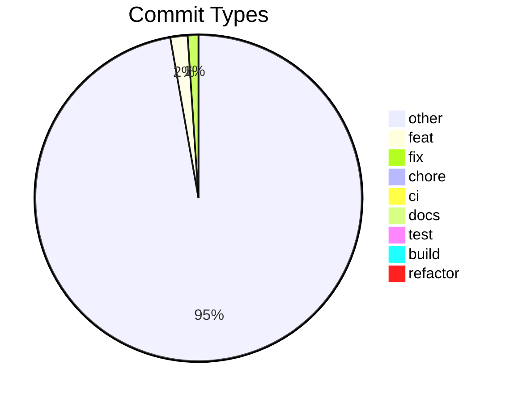

# Commit Change Log

Generated: 2026-10-24T08:27:49.492073+00:00
Source-State: run=iterate-2026-10-23-ci-actions-bump base=d4cdc705631a release=v1.5.0
Consistency-audit: never run
Total commits: 482

## Commit Distribution

## Changes by Type

### Other (other) — 457 commits

| Date | Scope | Description | Commit |
|------|-------|-------------|--------|
| 2026-01-19 | — | improve ux for address search | 897f67269933 |
| 2026-01-19 | — | improve ux for address search | f905d351f3fc |
| 2025-06-15 | — | dependencies | 92cb3e575653 |
| 2025-06-15 | — | Bump esbuild, @vitest/coverage-v8 and vitest | a145ed35ce43 |
| 2025-06-10 | — | Bump @vitejs/plugin-react from 4.3.3 to 4.5.2 | fa5ee0aff8b9 |
| 2025-05-21 | — | Bump @radix-ui/react-slot from 1.1.0 to 1.2.3 | bc47adaaa386 |
| 2025-05-05 | — | Bump vite from 5.4.14 to 6.3.5 | 67c5be9c1e38 |
| 2025-04-28 | — | remove broken Addresse reset button | b78aa8f8ba6a |
| 2025-04-28 | — | improve recipient address | 39357561523b |
| 2025-04-23 | — | Bump @radix-ui/react-toast from 1.2.2 to 1.2.11 | 917842389cb9 |
| 2025-04-23 | — | Bump @radix-ui/react-tooltip from 1.1.4 to 1.2.4 | 420da09dc11b |
| 2025-03-31 | — | Bump @supabase/supabase-js from 2.46.1 to 2.49.4 | 368259c295de |
| 2025-03-19 | — | Bump input-otp from 1.2.4 to 1.4.2 | f06c15a5b619 |
| 2025-03-18 | — | add two more buttons | b7bdc5834fc3 |
| 2025-03-18 | — | Bump jspdf from 3.0.0 to 3.0.1 | 9f6cd7349dc6 |
| 2025-03-16 | — | correctly display birthdate | 460b13bcaf14 |
| 2025-03-03 | — | loos | 0520bb670453 |
| 2025-02-28 | — | Bump vitest and @vitest/coverage-v8 | f5c183d17512 |
| 2025-02-28 | — | Bump dompurify and jspdf | b49d813d301e |
| 2025-02-28 | — | good enough | c4e710b952ef |
| 2025-02-28 | — | almost | 8cbf66647864 |
| 2025-02-28 | — | progress | 96c3d3f63230 |
| 2025-02-26 | — | die trying | bd7c496f35fb |
| 2025-02-25 | — | Bump vite from 5.4.11 to 6.2.0 | d7d605a00a8b |
| 2025-02-06 | — | Bump @radix-ui/react-tabs from 1.1.1 to 1.1.3 | 91c2a6e50109 |
| 2025-02-06 | — | Bump @radix-ui/react-avatar from 1.1.1 to 1.1.3 | 9b9e1fcd6cbd |
| 2025-01-22 | — | Bump vite from 5.4.11 to 5.4.14 | df5373273bdb |
| 2025-01-16 | — | Bump @testing-library/react from 16.0.1 to 16.2.0 | 7d65792cb08d |
| 2025-01-07 | — | Bump @radix-ui/react-slider from 1.2.1 to 1.2.2 | 729cad3929fc |
| 2025-01-07 | — | Bump eslint-plugin-react-hooks | 8947d7ed0040 |
| 2025-01-07 | — | Bump react-signature-canvas from 1.0.6 to 1.0.7 | 2dc57355268d |
| 2025-01-07 | — | remove dub | d9bb1a91e92d |
| 2025-01-07 | — | Fix signature deletion functionality | 1d87dd770cee |
| 2025-01-07 | — | Update README.md | 3a75b2ef7da0 |
| 2025-01-07 | — | remove dub | ab61b4bba129 |
| 2025-01-07 | — | Fix duplicate location display | ec8ad674ceef |
| 2025-01-07 | — | Fix address rendering in PDF | 5520059d6765 |
| 2025-01-07 | — | Update PLZ mapping for administration data | 48b64342e8d2 |
| 2025-01-07 | — | Fix PDF generation administration lookup | 444c5240a4b5 |
| 2024-12-07 | — | Remove build step from GitHub Actions | 85163bde03dd |
| 2024-12-07 | — | Update artifact actions to v4 | 0dfeaf9a7546 |
| 2024-12-07 | — | Fix test assertions in Index tests | cf6333a997dc |
| 2024-12-07 | — | Fix test failures due to ResizeObserver | 887fa2010b5c |
| 2024-12-07 | — | Fix import error in supabaseMock | 30942c192085 |
| 2024-12-07 | — | Fix test failures in Index component | 72aa4563cce4 |
| 2024-12-07 | — | Fix test errors and warnings | 9323ac44cb30 |
| 2024-12-07 | — | Fix test errors and warnings | 13136fc0cf08 |
| 2024-12-07 | — | update ci | 1793fef8f214 |
| 2024-12-07 | — | update package.json | 521032226989 |
| 2024-12-07 | — | Set up test utilities and mocks | 4541986e2d35 |
| 2024-12-07 | — | update package.json | afffd994865a |
| 2024-12-07 | — | Fix persistent issue behavior | d9f3e50d83fc |
| 2024-12-07 | — | Fix persistent issue behavior | 9f6876fa6ebc |
| 2024-12-07 | — | Fix test command for Vitest | ac08c5f41583 |
| 2024-12-07 | — | update package.json | 57a68497b61e |
| 2024-12-07 | — | update package.json | 8a0fcc8d778c |
| 2024-12-07 | — | continue | c593659fc2f5 |
| 2024-11-29 | — | upate package.json file | f205b49fba13 |
| 2024-11-29 | — | Update package.json file | c5fb7ae78d02 |
| 2024-11-29 | — | upate package.json file | 3db226fa87e0 |
| 2024-11-29 | — | Fix test command for no files found | ce9531ee048b |
| 2024-11-29 | — | Fix invalid workflow expression | 3170063f6e56 |
| 2024-11-29 | — | Fix workflow configuration issues | f44e7d017956 |
| 2024-11-29 | — | Update test file for manual dispatch | 41ed5f0bdb8f |
| 2024-11-29 | — | upate package.json file | 8965356a8cad |
| 2024-11-29 | — | Fix unknown option error in Vitest | 12598b9aadec |
| 2024-11-29 | — | upate package.json file | f8eee86d1b84 |
| 2024-11-29 | — | Fix test command option error | dbf315fdb461 |
| 2024-11-29 | — | Fix test command option error | 384892650177 |
| 2024-11-29 | — | Fix npm ci errors in tests | af050887de8b |
| 2024-11-29 | — | Rename Test Files for Clarity | 8543d6cf28d1 |
| 2024-11-29 | — | Add GitHub Action improvements | 0b50c17fb99f |
| 2024-11-29 | — | Refactor FormContainer component | 0317eeb78d8b |
| 2024-11-29 | — | Reverted to edit 2f5eed66-d558-4d05-8a05-f812fbea3baa: "Update codebase according to latest changes | 4deab5bb96b0 |
| 2024-11-29 | — | Improve architecture for testing support | a3e7b090746f |
| 2024-11-29 | — | Update codebase according to latest changes | 94ff528165de |
| 2024-11-29 | — | Update test files to use factories | 78c35e53e6ef |
| 2024-11-29 | — | Update codebase for improvements | 95dab018d022 |
| 2024-11-29 | — | Set up test data factories | 0b375d636b89 |
| 2024-11-29 | — | Reverted to edit b4ff90ca-7909-4b9e-88f4-5f41f4c08ea9: "Extract Business Logic into Services | e930c40d0616 |
| 2024-11-29 | — | Add address lookup service | 590299d70ed2 |
| 2024-11-29 | — | Extract Business Logic into Services | 897f68b2994c |
| 2024-11-29 | — | Remove administration fields connection | ed40ff3cc7d8 |
| 2024-11-29 | — | Fix missing property error | f333e5e34ce4 |
| 2024-11-29 | — | Fix type errors in FormContainer | 7131993093c5 |
| 2024-11-29 | — | Refactor FormFields Component | 3de69505418e |
| 2024-11-29 | — | Remove addressConfig.ts file | 6dcfcf8dae71 |
| 2024-11-29 | — | Fix import and type errors | d8e1e815a875 |
| 2024-11-29 | — | Remove addresses.ts usage | a679abe2e80b |
| 2024-11-29 | — | Focus on Testing Improvements | 93f8566b7fd1 |
| 2024-11-29 | — | Remove unused code elements | 3dbc00d4c382 |
| 2024-11-29 | — | Fix TypeScript errors in tests | 38fbcec0d808 |
| 2024-11-29 | — | Add tests for components and functions | 05b16cfbc39b |
| 2024-11-29 | — | Create API Service Layer | 0e454c001cbd |
| 2024-11-29 | — | Remove System Theme Option | eac3075fc702 |
| 2024-11-29 | — | Adjust Color for Dark Mode | 26324f556ffc |
| 2024-11-29 | — | Add dark mode feature | 7490caec1539 |
| 2024-11-29 | — | Remove separator line from UI | 879affbe64af |
| 2024-11-29 | — | Remove pinch and zoom buttons | 2cc5255a7181 |
| 2024-11-29 | — | Standardize form layout | a52387c31c74 |
| 2024-11-29 | — | Start PDF topic implementation | e9e2d70db993 |
| 2024-11-29 | — | Fix FormContainerProps error | 98ac4a69299a |
| 2024-11-29 | — | Fix PDF rendering button functionality | 0767ab1ba5fe |
| 2024-11-29 | — | Remove obsolete button from code | 0c56fc46698f |
| 2024-11-29 | — | Move button to same line | 63a3466be498 |
| 2024-11-29 | — | Remove unnecessary code or provide explanation. | 8c4fc7441a39 |
| 2024-11-29 | — | Add PDF preview enhancements | f509140be8e7 |
| 2024-11-29 | — | Remove download and print buttons | a03739578fec |
| 2024-11-29 | — | Fix download and print buttons on iOS | 50586f5f2f44 |
| 2024-11-29 | — | Add PDF menu for mobile Safari | bcc08af43316 |
| 2024-11-29 | — | Fix type error in Index.tsx | cbf2aedb6a65 |
| 2024-11-29 | — | Fix mobile address selection issue | ad19ef3854c5 |
| 2024-11-29 | — | Revert "Fix type error in Index.tsx" | a62aec13048a |
| 2024-11-29 | — | Fix type error in Index.tsx | 081ccfb680a8 |
| 2024-11-29 | — | Adjust div size for parent containment | 581bcd822f89 |
| 2024-11-29 | — | Reverted to edit eae869f5-de81-4515-a82d-bacbdcfca8e0: "Remove PDFPreview component | 8617a0badc32 |
| 2024-11-29 | — | Remove unused div and references | bfa3da782505 |
| 2024-11-29 | — | Fix type error in Index.tsx | b46226fc3880 |
| 2024-11-29 | — | Remove PDFPreview component | 7f53eecfc03e |
| 2024-11-29 | — | Refactor PDF generation buttons | 351622e60728 |
| 2024-11-29 | — | Optimize mobile and desktop experience | cf20feba2531 |
| 2024-11-29 | — | Reverted to edit d6218cf9-f533-4cac-8cb7-803946cb6bde: "Improve responsive design and usability | d50868ac864c |
| 2024-11-29 | — | Update codebase and refactor files | 954745381a7f |
| 2024-11-29 | — | Improve responsive design and usability | 3032c6effa03 |
| 2024-11-28 | — | Run reviewed SQL queries | 00de0fa01d0e |
| 2024-11-28 | — | ease address | 5276d3191f32 |
| 2024-11-28 | — | Run reviewed SQL queries | 1dbc14238303 |
| 2024-11-28 | — | Update date placeholder text | 3c51c9ae0175 |
| 2024-11-28 | — | Translate placeholder to German | c0b1eec697b1 |
| 2024-11-28 | — | update readme | 3ad57c94443a |
| 2024-11-23 | — | update dependabot | 33bc40c487eb |
| 2024-11-23 | — | update gitignore | 2f75648a7326 |
| 2024-11-23 | — | Bump next-themes from 0.3.0 to 0.4.3 | ff3ff3a05702 |
| 2024-11-23 | — | Bump cross-spawn from 7.0.3 to 7.0.6 | ba78c59bc7b7 |
| 2024-11-18 | — | Bump react-resizable-panels from 2.1.5 to 2.1.7 | e3e8c9be4089 |
| 2024-11-18 | — | Bump lucide-react from 0.459.0 to 0.460.0 | 52eb2a16be6d |
| 2024-11-18 | — | Bump @radix-ui/react-tooltip from 1.1.3 to 1.1.4 | d41907f9c399 |
| 2024-11-21 | — | Bump embla-carousel-react from 8.3.0 to 8.5.1 | 4ab52ea5ce22 |
| 2024-11-16 | — | update README | f22bd165d64e |
| 2024-11-16 | — | update pricing for betreuung der gebaehrenden zuhause | 411c2710da69 |
| 2024-11-15 | — | update addresses based on Adressen_Wartgeld 2023.doc | 342758e95667 |
| 2024-11-15 | — | Bump vaul from 0.9.9 to 1.1.1 | a85d232645e1 |
| 2024-11-15 | — | Bump vite from 5.4.10 to 5.4.11 | 5a09354e348e |
| 2024-11-15 | — | Bump postcss from 8.4.47 to 8.4.49 | 2937f068864a |
| 2024-11-15 | — | Bump lucide-react from 0.451.0 to 0.459.0 | 47a58afeb50e |
| 2024-11-15 | — | Bump sonner from 1.5.0 to 1.7.0 | bec4fe01bd02 |
| 2024-11-28 | — | Remove progress bar from form | 51899f2f5aa2 |
| 2024-11-28 | — | Update Betreuung Geburt cost | d86dd645aedb |
| 2024-11-28 | — | Add checkbox for service selection | 507c73abc9d1 |
| 2024-11-28 | — | Reverted to edit 0b72704c-2768-4809-98e7-fa906c29b8d1: "Fix import errors in FormContainer | 82ec4c6cf4d9 |
| 2024-11-28 | — | Refactor form to single page | 911422c3b7c9 |
| 2024-11-28 | — | Fix TypeScript error in Index.tsx | 0567ed644a72 |
| 2024-11-28 | — | Fix input errors and type mismatch | b337c2577919 |
| 2024-11-28 | — | Fix TypeScript errors in form components | 2b9b54f91687 |
| 2024-11-28 | — | Fix TypeScript errors in tests | ae12e61d983b |
| 2024-11-28 | — | Fix errors in API calls and types | 20eeece2ec34 |
| 2024-11-28 | — | Fix TypeScript errors in Index.tsx | afdaeff0f034 |
| 2024-11-28 | — | Run reviewed SQL code | 723ed9d80450 |
| 2024-11-28 | — | Add state management with Tanstack Query | f0688d7eaa46 |
| 2024-11-28 | — | Fix import errors in FormContainer | aca3fca2bc30 |
| 2024-11-28 | — | Reorganize components folder structure | dfa6bc85a14f |
| 2024-11-28 | — | Fix import errors in FormFields.tsx | aaf75ee2b01f |
| 2024-11-28 | — | Fix package installation error | dcfd907cb131 |
| 2024-11-28 | — | Remove progress bar component | 2a425aaedd50 |
| 2024-11-28 | — | Remove specified content from page | 5c39e5e6981b |
| 2024-11-28 | — | Add service selection options | 49585f5deced |
| 2024-11-28 | — | Add checkboxes to form fields | a8c67f6293e6 |
| 2024-11-28 | — | Add visibility for components | 156e4ed18f49 |
| 2024-11-28 | — | Re-add service selection checkboxes | 77d4d8a45921 |
| 2024-11-28 | — | Add toast auto-dismiss feature | ca992c385057 |
| 2024-11-28 | — | Reset form inputs and cache | 2b4423bfe560 |
| 2024-11-23 | — | update dependabot | a9829ca8bcb4 |
| 2024-11-23 | — | update gitignore | 4d82a11bc184 |
| 2024-11-23 | — | Bump next-themes from 0.3.0 to 0.4.3 | 44c67d4ec86a |
| 2024-11-23 | — | Bump cross-spawn from 7.0.3 to 7.0.6 | c45583984a2c |
| 2024-11-23 | — | Fix TypeScript error in useZipAutocomplete | a8b67f984135 |
| 2024-11-23 | — | Remove zip code caching policy | b67ca9cfc8eb |
| 2024-11-23 | — | Add logging for API response | 2739299da5ec |
| 2024-11-23 | — | Reverted to edit aea7a954-7fa6-4248-bc6d-476a087bf069: "Add logging for filtered payload | 6bf7fea0891c |
| 2024-11-23 | — | Add house number search functionality | e47c9a2912b9 |
| 2024-11-23 | — | Fix Supabase function fetch error | e130bd2635a2 |
| 2024-11-23 | — | Fix TypeScript error in useStreetAutocomplete | 8ee55cf6a1d2 |
| 2024-11-23 | — | Update API calls on input change | cb9073f06426 |
| 2024-11-23 | — | Add logging for filtered payload | 8fcd62941f68 |
| 2024-11-23 | — | Implement address search enhancements | 1f08d8538508 |
| 2024-11-22 | — | Clear address input on button click | 76e56e3acb1c |
| 2024-11-22 | — | Reduce Verbose Logging in Address Lookup | b50fa7409446 |
| 2024-11-22 | — | Reset Button Functionality Implemented | 256c91e6ee1b |
| 2024-11-21 | — | Add ZipCode filter for API requests | 957c630f6ce7 |
| 2024-11-21 | — | Remove Canton ZG Filter | 8ed9f607b3c6 |
| 2024-11-21 | — | Investigate address suggestion issue | df3e960ca240 |
| 2024-11-21 | — | Enhance address autocomplete recommendations | cd691beea0e6 |
| 2024-11-21 | — | Reverted to edit c18116cd-6d2c-4d6a-a0ff-f6376b8c3559: "Remove Postleitzahl & Ort Fields | eca34c3a4d3b |
| 2024-11-21 | — | Make Suggestions List Scrollable | 3e56523fb0c9 |
| 2024-11-21 | — | Remove Postleitzahl & Ort Fields | 27c0672ef36d |
| 2024-11-21 | — | Fix address display in suggestions | de68d4015a10 |
| 2024-11-21 | — | Fix import errors in StreetLookup | d6ad554f2aef |
| 2024-11-21 | — | Implement tab completion for suggestions | 00c62810b6ab |
| 2024-11-21 | — | Remove error messages on valid input | 2b12914df9e9 |
| 2024-11-21 | — | Update street suggestions display | 387b7cff6c1d |
| 2024-11-21 | — | Bump embla-carousel-react from 8.3.0 to 8.5.1 | a1e2dcd46c49 |
| 2024-11-21 | — | Fix missing onAddressChange prop | fffa3ba84500 |
| 2024-11-21 | — | Auto-complete form with selected address | bddb5c1c39fa |
| 2024-11-21 | — | Complete address on selection | ddf58952d991 |
| 2024-11-21 | — | Improve address search functionality | 42d54d34e9a4 |
| 2024-11-21 | — | Refactor address filter function | fe5d05e1898f |
| 2024-11-21 | — | Improve address search functionality | 4b24941cfd2f |
| 2024-11-21 | — | update placeholder text | 56f5eb909add |
| 2024-11-21 | — | Remove postleitzahl & Ort field | 13c080650118 |
| 2024-11-21 | — | Implement code improvements | ad293df36675 |
| 2024-11-21 | — | Re-enable form functionality | 49848293b8db |
| 2024-11-21 | — | Re-enable ZipCode and Town search | 1f2405ef9f5a |
| 2024-11-21 | — | Remove streetFilter from addressConfig | 9f175d405232 |
| 2024-11-21 | — | Fix TypeScript errors in StreetLookup | dd8669e737c4 |
| 2024-11-21 | — | Improve street search field suggestions | ddaf5a3475d5 |
| 2024-11-21 | — | Fix missing onClear property | a2fd773cb30b |
| 2024-11-21 | — | Implement suggestions from prompt | d92eaaa4be80 |
| 2024-11-21 | — | Fix missing onKeyDown prop | 64c95b17e7a3 |
| 2024-11-21 | — | Fix address lookup integration issues | 65b6f62a148a |
| 2024-11-21 | — | Add support for street and house number search | 4acc4b7b7c56 |
| 2024-11-21 | — | Improve street autosuggestion limits | e23a363a4591 |
| 2024-11-21 | — | Clear Postleitzahl & Ort on Adresse clear | 5e161e672386 |
| 2024-11-21 | — | Clear placeholder and fields on clear action | c4932bb6acd7 |
| 2024-11-21 | — | Add house number suggestions feature | c4c908a09298 |
| 2024-11-21 | — | Remove unused zip code & city field | bf479932a1ce |
| 2024-11-21 | — | Fix address autosuggestions | b66db88b97ce |
| 2024-11-21 | — | Revert autosuggestion change | f76e741843b2 |
| 2024-11-21 | — | Update address and PLZ/Ort synchronization | 98b692090b14 |
| 2024-11-21 | — | Fix TypeScript errors in StreetLookup | 600da779730f |
| 2024-11-21 | — | Enable keyboard navigation for suggestions | 675aa579d167 |
| 2024-11-21 | — | Update Zip & City Lookup Logic | ffebad370e8f |
| 2024-11-21 | — | Implement ZIP and city suggestions | 115078adab55 |
| 2024-11-21 | — | Fix TypeScript errors in lookup components | d9579da23565 |
| 2024-11-21 | — | Improve address autocomplete UX | 9d3ead9df0f1 |
| 2024-11-21 | — | Add zip code filter configuration | d4e89a2f89a0 |
| 2024-11-21 | — | Fix import error for ZipSuggestion | c06def4f99d6 |
| 2024-11-21 | — | Fix frontend data display issue | 5f2a489422d1 |
| 2024-11-21 | — | Update components to use real API data | 8cea7cce0f6f |
| 2024-11-21 | — | Add ZipCode filter to edge function | 15c924cd6a41 |
| 2024-11-21 | — | update package lock | cbeff35a069b |
| 2024-11-21 | — | update gitignore | a6d885fbefea |
| 2024-11-21 | — | Implement address autocomplete API integration | 799ef5f97081 |
| 2024-11-21 | — | Implement edge function for autocomplete | debf98e9d5f6 |
| 2024-11-21 | — | Fetch API endpoint on each request | 65303c4c7983 |
| 2024-11-21 | — | Update API credentials handling | 13acafb91619 |
| 2024-11-21 | — | Run reviewed SQL script | 6f597965e1f6 |
| 2024-11-21 | — | Replace Mock API with Supabase Integration | 6cd996509138 |
| 2024-11-21 | — | Connect Supabase project `wartgeld-generator-zug` | 60aefe3c7761 |
| 2024-11-21 | — | Reverted to edit 3755e034-6864-43ac-be31-c49086fe8e69: "Add street suggestion filter | 3b3ec9b933ec |
| 2024-11-20 | — | Add allowed origin for wartgeld.traintown.solutions | d185e02213a3 |
| 2024-11-20 | — | Add lovableproject.com to allowed origins | 63ec25324153 |
| 2024-11-20 | — | Add URL origin to config | cc8aec617e09 |
| 2024-11-20 | — | Add CORS support for localhost | 60c2142283e6 |
| 2024-11-20 | — | Update CORS headers for fetch | c649a615d8bf |
| 2024-11-20 | — | Add logging to API calls | d7f76076776e |
| 2024-11-20 | — | Add environment variable explanation | ab42152e628b |
| 2024-11-20 | — | Update API endpoint configuration | 14f5578e977d |
| 2024-11-20 | — | Complete API Integration | eb2cfd1c0de9 |
| 2024-11-20 | — | Rename API environment variable | 93118c2440d9 |
| 2024-11-20 | — | update gitignore | 00e1409be567 |
| 2024-11-20 | — | Add missing apiConfig.ts file | fdb40f96ba31 |
| 2024-11-20 | — | Add street suggestion filter | 4f34558b96a9 |
| 2024-11-20 | — | Update street autocomplete suggestions | ba4edc10401a |
| 2024-11-20 | — | Add tab completion for suggestions | e808bf3de76d |
| 2024-11-20 | — | Implement Address and Zip Code Coordination | 528287fd6857 |
| 2024-11-20 | — | Add clear button for ZipCityLookup | 7698b28a1772 |
| 2024-11-20 | — | Fix autocompletion dropdown trigger | 9163c022f368 |
| 2024-11-20 | — | Refactor street lookup autocompletion | cdcbb7f5e310 |
| 2024-11-20 | — | Refactor Address Autocompletion | 32a2bb5ca2bf |
| 2024-11-20 | — | Fix bug in ZipCityLookup component | fc599157ec52 |
| 2024-11-20 | — | Fix field clearing bug | 9534c88f82fd |
| 2024-11-20 | — | Update code base following suggestions | 7d1c433f2e72 |
| 2024-11-20 | — | Add house number autocomplete data | ffd0527b8140 |
| 2024-11-20 | — | Add autocomplete for street addresses | 012461fa57fb |
| 2024-11-20 | — | Implement user-friendly address form | c8e3c75f7219 |
| 2024-11-20 | — | Reverted to edit a05c18ca-5c52-4723-8590-c229ef5b003f: "Extend autocomplete for street name | 541cfc66d2b1 |
| 2024-11-20 | — | Extend mock API for house number autocomplete | 2a96838210d9 |
| 2024-11-20 | — | Extend autocomplete for street name | c9d606b4e7a3 |
| 2024-11-20 | — | Update mock API specifications | a6dac673b073 |
| 2024-11-18 | — | Bump @radix-ui/react-tooltip from 1.1.3 to 1.1.4 | 90c263d2eb0a |
| 2024-11-18 | — | Bump lucide-react from 0.459.0 to 0.460.0 | ca5599c2f33d |
| 2024-11-18 | — | Bump react-resizable-panels from 2.1.5 to 2.1.7 | f7509ca9938b |
| 2024-11-16 | — | update README | cbf440173bfb |
| 2024-11-16 | — | update pricing for betreuung der gebaehrenden zuhause | 642bff87bfc8 |
| 2024-11-15 | — | update addresses based on Adressen_Wartgeld 2023.doc | d23f70ad6f71 |
| 2024-11-15 | — | Add autocomplete feature | d61e4c025c80 |
| 2024-11-15 | — | Bump vaul from 0.9.9 to 1.1.1 | 74a15c5cc55c |
| 2024-11-15 | — | Bump sonner from 1.5.0 to 1.7.0 | a993db22d06c |
| 2024-11-15 | — | Bump lucide-react from 0.451.0 to 0.459.0 | b6f8c9cc08cd |
| 2024-11-15 | — | Bump postcss from 8.4.47 to 8.4.49 | 7f480ed6de42 |
| 2024-11-15 | — | Bump vite from 5.4.10 to 5.4.11 | e954f8f3cdaa |
| 2024-11-15 | — | Fix export error in ZipCityLookup | 0b7dd3ca18bd |
| 2024-11-15 | — | Implement mock API for address autocomplete | 19ba8ca4a47a |
| 2024-11-15 | — | Enhance search and autocomplete usability | 26edd2d6e4cd |
| 2024-11-14 | — | Fix postMessage origin error | 31a64ad0ab58 |
| 2024-11-14 | — | Fix label id references | 2e78e5680364 |
| 2024-11-14 | — | Identify error location in code | c698faf5d9d3 |
| 2024-11-14 | — | Fix issue with functionality | 2e0be055ae4a |
| 2024-11-14 | — | Fix iterable error in zip search | 12b87546df64 |
| 2024-11-14 | — | Fix runtime TypeError in component | 1bcfb1dcea9c |
| 2024-11-14 | — | Add error boundary implementation | ad10ac91afd1 |
| 2024-11-14 | — | Fix app crash on input | 8e718c18a5e8 |
| 2024-11-14 | — | Fix undefined iterable error | d959d997f711 |
| 2024-11-14 | — | Update form to accept alphanumeric input | c1fea77dc902 |
| 2024-11-14 | — | Fix runtime TypeError issue | 4d8eeebcaafc |
| 2024-11-14 | — | Fix iterable error in code | c3d4e026befa |
| 2024-11-14 | — | Fix undefined error in code | 459af710973d |
| 2024-11-14 | — | Fix runtime iterator error | 45bdc37278dd |
| 2024-11-14 | — | Fix undefined is not iterable error | 9ca4e9514b46 |
| 2024-11-14 | — | Fix export issues in mockAddressApi | caf25bf6a8ca |
| 2024-11-14 | — | Fix runtime TypeError | c555179b6096 |
| 2024-11-14 | — | Create mock API for address autocomplete | 329060a29c21 |
| 2024-11-14 | — | Remove failing tests from coverage reports | d520e57369fb |
| 2024-11-14 | — | Add additional tests for coverage | 5e43c64fd875 |
| 2024-11-14 | — | Add coverage reporting to tests | d2fed02a83a3 |
| 2024-11-14 | — | add test coverage | a3afd08c4eef |
| 2024-11-14 | — | Check current test coverage | 70b35eaf0c61 |
| 2024-11-14 | — | Add simple test case | 88b036c9435f |
| 2024-11-14 | — | Remove failing tests | d0a97bde2e24 |
| 2024-11-14 | — | Remove problematic tests and simplify | 67e945a24044 |
| 2024-11-14 | — | Fix dependency and TypeScript errors | 2cc67111ab88 |
| 2024-11-14 | — | Fix test setup issues | dfc8153b6c10 |
| 2024-11-14 | — | Fix test setup issues | 8c54deb5ad09 |
| 2024-11-14 | — | trigger | 65c880afbe2a |
| 2024-11-14 | — | trigger | e7cc8c38b114 |
| 2024-11-14 | — | trigger | bb7fa4d5a9b7 |
| 2024-11-14 | — | Enable manual triggering of test action | f549137563b5 |
| 2024-11-14 | — | Implement tests explanation | 955ae0a1fb79 |
| 2024-11-14 | — | Reverted to edit 4ee04715-e80e-4b19-b0d8-aab94a046432: "Update CI config for tests | 9b8dd234e437 |
| 2024-11-14 | — | Fix missing test script in package.json | 2c613c86c29f |
| 2024-11-14 | — | Update CI configuration for npm sync | cdd0cda70a20 |
| 2024-11-14 | — | Update CI config for tests | c4b54106f8c6 |
| 2024-11-14 | — | Add GitHub Action for Tests | d8c2ea68337f |
| 2024-11-14 | — | Fix TypeScript errors | cb340b099961 |
| 2024-11-14 | — | Add test coverage for app | 112f2b50ad32 |
| 2024-11-14 | — | Bump @tanstack/react-query from 5.59.16 to 5.60.2 | 0ac26d40f29b |
| 2024-11-13 | — | make pdf more nice | 20344092829d |
| 2024-11-13 | — | create new feature branch for pdf render | 583a94c1cb1f |
| 2024-11-13 | — | Reverted to edit b166562b-ddf5-47ca-8bf0-2db063704797: "Improve settings save logic | f782744111e9 |
| 2024-11-13 | — | Revert to jsPDF with Brackets | 7b63820b825b |
| 2024-11-13 | — | Replace PDF generation with pdfme | a873e42a2998 |
| 2024-11-13 | — | Retry code change implementation. | e87294497468 |
| 2024-11-13 | — | Add radio button functionality | ebe11cb9879e |
| 2024-11-13 | — | Add radio buttons for selection | 3a17f0c3a936 |
| 2024-11-13 | — | Add AcroFormCheckBox class and interface | 70eafec62738 |
| 2024-11-13 | — | Set boolean values using On and Off | f495ccb7948b |
| 2024-11-13 | — | update checkbox value | eeb4acd72831 |
| 2024-11-13 | — | Add checkbox per item in form | 902d4fe38099 |
| 2024-11-13 | — | Add checkbox implementation example | e70ce6255ccc |
| 2024-11-13 | — | Reverted to edit 8ef38e3e-e1ae-4544-ba61-0dc2b961d812: "Update Checkbox Indicators to Emojis | f6c74ab1ef99 |
| 2024-11-13 | — | Add checkbox rendering example | ee0e8d4b9360 |
| 2024-11-13 | — | Bump @types/node from 22.7.9 to 22.9.0 | 33b143cd947e |
| 2024-11-13 | — | Bump react-day-picker from 8.10.1 to 9.3.0 | cea7a1fb6bc5 |
| 2024-11-13 | — | Reverted to edit 8ef38e3e-e1ae-4544-ba61-0dc2b961d812: "Update Checkbox Indicators to Emojis | 627b0cbd56ab |
| 2024-11-13 | — | Try alternative PDF package | 9406208c020a |
| 2024-11-13 | — | Update Checkbox Indicators to Emojis | 8ecc1c91d6f4 |
| 2024-11-13 | — | Investigate potential causes for issues | 0c73b8bd2315 |
| 2024-11-13 | — | Update font to support UTF-8 | b30f7ef87b44 |
| 2024-11-13 | — | Fix PDF rendering issue | 3b81f944c746 |
| 2024-11-13 | — | Update checkbox characters for UTF-8 support | 4ee46fe6a207 |
| 2024-11-13 | — | Use Manrope-Medium Font | 2b21f133510c |
| 2024-11-13 | — | use manrope | afa65eb44fb7 |
| 2024-11-13 | — | add fonts | 5147af55396b |
| 2024-11-13 | — | add ttf font file | d44faaa007dd |
| 2024-11-13 | — | Add UTF-8 support for PDF | 7d730520b7ba |
| 2024-11-13 | — | Improve settings save logic | c09581bd95e9 |
| 2024-11-13 | — | Remove Button Animation and Add Notification Dot | f8b4d46c0ca9 |
| 2024-11-13 | — | add badge | c64a7b865bfa |
| 2024-11-09 | — | Disable button animation on save | 44a436e5f287 |
| 2024-11-09 | — | Bump react-hook-form from 7.53.1 to 7.53.2 | 7aaf1e5d847f |
| 2024-11-09 | — | Bump @eslint/js from 9.13.0 to 9.14.0 | e1c3b0e522c4 |
| 2024-11-09 | — | Update dependabot.yml | 2ce7df4331de |
| 2024-11-09 | — | Create dependabot.yml | fbe1a64a8676 |
| 2024-11-09 | — | Add availability disclaimer to Info page | 82cfb9f1a202 |
| 2024-11-09 | — | Remove GCP deployment files | 30db2226cc40 |
| 2024-11-09 | — | add gcloudignore file | a53c90df23d8 |
| 2024-11-09 | — | Deploy to Google Cloud App Engine | 421b25a0f669 |
| 2024-11-08 | — | Reverted to edit 90bbc347-3a5a-4bf3-9662-39a5dc7971dc: "Fix PDF emoji rendering issue | 7d7ad92e8457 |
| 2024-11-08 | — | Add font loading functionality | 7c1ecad8aa75 |
| 2024-11-08 | — | Fix PDF emoji rendering issue | 3459ed9ecd09 |
| 2024-11-08 | — | layout | 855dc17701a3 |
| 2024-11-08 | — | Reverted to edit 2b79f4bd-5dd0-427c-bab7-091011fa748f: "Update deploy.yml" | 11f3834af18b |
| 2024-11-08 | — | Implement Content Security Policy Fix | e6b744fe3876 |
| 2024-11-08 | — | Reverted to edit 2b79f4bd-5dd0-427c-bab7-091011fa748f: "Update deploy.yml" | 62df0eb94e2d |
| 2024-11-08 | — | Fix checkbox size in PDF | 6890799bb1e4 |
| 2024-11-09 | — | Update deploy.yml | c62b852d3810 |
| 2024-11-08 | — | Fix 404 Resource Loading Issues | 86c379a70303 |
| 2024-11-08 | — | Fix deployment issue | 2feb827b8abb |
| 2024-11-08 | — | Fix file permission error | 65ef278f9a47 |
| 2024-11-08 | — | Remove sentence from info page | 5d0c915d0e2f |
| 2024-11-08 | — | Deploy workflow information update | a68f87ba6ff7 |
| 2024-11-08 | — | Update date input placeholder | 7cb17f2cff39 |
| 2024-11-08 | — | Translate "Save Settings" to "Speichern" | 7fb21b454424 |
| 2024-11-08 | — | Update label text in Settings page | dde14b9262fd |
| 2024-11-08 | — | Separate Ort & Datum Section | 8850c0a0944a |
| 2024-11-08 | — | Improve Signature Features | 4719331b458d |
| 2024-11-08 | — | Add signature setting and PDF integration | a089119812ac |
| 2024-11-08 | — | Update navigation and remove text | edf2f23cafa8 |
| 2024-11-08 | — | Update Settings Page UI | 931c3abadf55 |
| 2024-11-08 | — | Add navigation from Info page | 8d67ce525535 |
| 2024-11-08 | — | update adresses | 41149bf30ede |
| 2024-11-08 | — | Add Kontakt section to Info page | d5cfc357fbab |
| 2024-11-08 | — | Update Info section header and contact details | fd99f080f805 |
| 2024-11-08 | — | Update Impressum to Kontakt | e00bbe4413bc |
| 2024-11-08 | — | Add privacy information and imprint | 321484f018da |
| 2024-11-08 | — | Add info page navigation | c75d033811f9 |
| 2024-11-08 | — | Add information button next to settings | 2d7e5bc55916 |
| 2024-11-08 | — | Translate Toast Messages to German | 53420c640967 |
| 2024-11-08 | — | Adjust Red Color and Animation | fb9d9e8c1175 |
| 2024-11-08 | — | Refactor Index.tsx for clarity | ecac221ddded |
| 2024-11-08 | — | Improve UI Option for Functionality | 262c15a772bc |
| 2024-11-08 | — | Refine badge appearance | 930fd7d8e0cd |
| 2024-11-08 | — | Add visual hint for settings button | a8330e437bbc |
| 2024-11-08 | — | Add punctuation to sentence | 50745439fec1 |
| 2024-11-08 | — | Change button label | c2fa3d3e5a72 |
| 2024-11-08 | — | Change placeholder text layout | 02eb58668d6d |
| 2024-11-08 | — | Update layout and title of preview | de4762977600 |
| 2024-11-08 | — | Add heading to FormFields | 53aad880efb1 |
| 2024-11-08 | — | Move address data to config file | d9d576d477f1 |
| 2024-11-08 | — | Remove Manage Presets Section | b5b7b66fc08b |
| 2024-11-08 | — | Fix newline issues in components | 70c00b3ed9f0 |
| 2024-11-08 | — | Update placeholder in Rechnungsstellerin | 72fca17f9936 |
| 2024-11-08 | — | Update placeholder in settings | 22b2e7edc144 |
| 2024-11-08 | — | Rename Settings Page and Labels | 3912b2680454 |
| 2024-11-08 | — | Change title to "Hebammenwartgeld Kanton Zug" | f35351b0d862 |
| 2024-11-08 | — | Change project title to Wartgeld Generator Kanton Zug | 5f9c36b813b1 |
| 2024-11-08 | — | layout | c1855f646f61 |
| 2024-11-08 | — | Replace horizontal line with variables | 640783fecaf5 |
| 2024-11-08 | — | Add "Ort Rechnungssteller" setting | ee066728385a |
| 2024-11-08 | — | Update sender information settings | 67070b9ba9e7 |
| 2024-11-08 | — | Update PDF Checkbox Rendering | 56f27cea1f5c |
| 2024-11-08 | — | Add services with checkboxes to form | cc410b2afd21 |
| 2024-11-08 | — | layout | aa1f4fbdca6b |
| 2024-11-08 | — | layout | b1ffdf2c7dba |
| 2024-11-08 | — | Fix PDF rendering issue | 3ba6882b4317 |
| 2024-11-08 | — | layout | 9d027e3803cb |
| 2024-11-08 | — | layout | 5ed2f4637cdf |
| 2024-11-08 | — | Move up subsequent lines in code | b0d5c9ce2ad5 |
| 2024-11-08 | — | Move 'Betreuung von' text position | d0b5f610d21a |
| 2024-11-08 | — | Reverted to edit 0b103852-8833-47c4-bd69-f4af4d455c50: "Update PDF formatting for details | f406f2385b53 |
| 2024-11-08 | — | Refactor form generation process | ee2326febdc4 |
| 2024-11-08 | — | Update PDF formatting for details | 102c4e14c4a7 |
| 2024-11-08 | — | Reverted to edit 5ea64eb8-2081-4a2a-9ed8-4b6b260c7b73: "Decrease line spacing in form | 7cefa8d99423 |
| 2024-11-08 | — | Remove spacing in PDF generator | 673dd24638f4 |
| 2024-11-08 | — | Decrease line spacing in form | 364f8f70d1de |
| 2024-11-08 | — | Bold and resize text elements | 00d42d21a5cd |
| 2024-11-08 | — | Make sender information compact | a73885defaf2 |
| 2024-11-08 | — | Adjust PDF Recipient Address Position | 53ba3a9f8dd9 |
| 2024-11-08 | — | Add PDF layout considerations | d679e10f707d |
| 2024-11-08 | — | Add recipient address generation feature | 09df011d1360 |
| 2024-11-08 | — | Remove additional notes field | 8284cbf6fdd7 |
| 2024-11-08 | — | Remove Address Lookup Field | e418d0c049bb |
| 2024-11-08 | — | Implement Address Search Form | 0e98ae9e4826 |
| 2024-11-08 | — | Fix TypeScript errors in components | 5fc920e486d2 |
| 2024-11-08 | — | Adjust form to new input requirements | 0650a8f3e896 |
| 2024-11-08 | — | Add form data collection feature | 896da239ab4d |
| 2024-11-08 | — | Use tech stack vite_react_shadcn_ts [skip gpt_engineer] | 3e012665e8ff |

### Features (feat) — 8 commits

| Date | Scope | Description | Commit |
|------|-------|-------------|--------|
| 2026-10-22 | ui | redesign settings and information pages with setup status and German theme menu (#180) | 8b2f1e8c5183 |
| 2026-10-22 | ui | redesign the invoice page with preview panel and phone sheet (#179) | c2f57f214883 |
| 2026-10-22 | ui | adopt the Papier & Tanne theme with bundled fonts (#178) | ec3e7726e987 |
| 2026-10-22 | hosting | serve the app from Bunny at wartgeld.nidea.ch (#177) | 6a848e01c530 |
| 2026-10-21 | address | Swiss Post APIM lookup via Bunny edge service, drop Supabase (#176) | 476d9e96f2d6 |
| 2026-10-21 | invoice | propose the responsible Zug municipality from bundled official data (#175) | d8e67a46633d |
| 2026-09-28 | security | lock down the address-lookup edge function | 79119f0994a7 |
| 2026-09-28 | — | PLZ validation, working invoice date setting, German UI text | b7c5285402be |

### Fixes (fix) — 5 commits

| Date | Scope | Description | Commit |
|------|-------|-------------|--------|
| 2026-10-23 | deps | apply in-range security updates to npm dependencies (#184) | 7148cd0337f9 |
| 2026-10-23 | deps | upgrade jspdf to 4.2.1 to close critical CVEs (#183) | b47b0e533480 |
| 2026-10-22 | print | print on iPhone and iPad through the share menu (#182) | dc58674f5ae3 |
| 2026-09-28 | — | generate the PDF once per submit and fix address result ordering | ad8bd9ac683e |
| 2026-09-28 | — | green lint, typecheck and tests; enforce them in CI | ded85ba21fd6 |

### Chores (chore) — 4 commits

| Date | Scope | Description | Commit |
|------|-------|-------------|--------|
| 2026-10-23 | security | mark the two remaining Semgrep findings as false positives (#200) | f54c211c2f33 |
| 2026-10-20 | shipwright | adopt repository into Shipwright SDLC | e951e7b4f021 |
| 2026-09-28 | — | remove dead code, unused UI components and dependencies | 22f7d69c5230 |
| 2026-01-18 | — | upgrade supabase postgres version and update gitignore | 87e26ff8a3b2 |

### CI/CD (ci) — 3 commits

| Date | Scope | Description | Commit |
|------|-------|-------------|--------|
| 2026-10-24 | — | bump pinned GitHub Actions to current majors (#203) | d4cdc705631a |
| 2026-10-23 | security | pin GitHub Actions to commit SHAs and add Dependabot cooldown (#194) | 6c1697ef6f73 |
| 2026-10-21 | — | allow the coverage step to comment on pull requests | 73ea2567585c |

### Documentation (docs) — 2 commits

| Date | Scope | Description | Commit |
|------|-------|-------------|--------|
| 2026-09-28 | — | record implementation status of the improvement plan | 9b51cbd98fbc |
| 2026-09-28 | — | add improvement plan for review findings 1-5 | b0e35115fba7 |

### Tests (test) — 1 commits

| Date | Scope | Description | Commit |
|------|-------|-------------|--------|
| 2026-10-23 | — | enforce the 80% coverage minimum and declare Node >=22.12 (#202) | 28330284dc17 |

### Build (build) — 1 commits

| Date | Scope | Description | Commit |
|------|-------|-------------|--------|
| 2026-10-23 | deps | upgrade vitest to 5.0.5 and run CI on Node 22 (#201) | efbe3cb45406 |

### Refactoring (refactor) — 1 commits

| Date | Scope | Description | Commit |
|------|-------|-------------|--------|
| 2026-09-28 | — | share PDF blob helper, split bundle, enable strict TypeScript | 7ac7ddc03da9 |

## AI Attribution

| Metric | Value |
|--------|-------|
| Total commits | 482 |
| AI-assisted commits | 8 |
| Human-authored commits | 474 |

