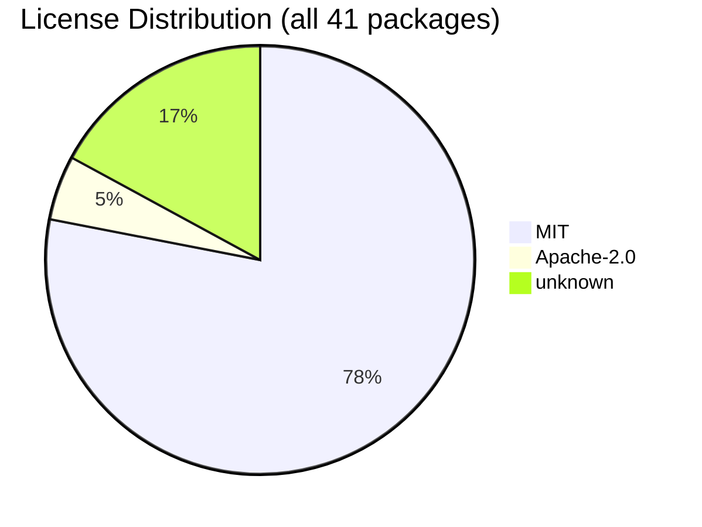

# Software Bill of Materials (SBOM)

Generated: (no events)
Source-State: run=(unknown) base=49c0ddaa837e
Consistency-audit: never run

## Summary

| Metric | Value |
|--------|-------|
| Runtime dependencies | 19 |
| Dev dependencies | 22 |
| Total packages | 41 |
| Licenses resolved | 34 / 41 |
| Unique licenses | 2 (Apache-2.0, MIT) |
| Copyleft licenses | 0 |

## License Distribution

## Runtime Dependencies

| Package | Version | License |
|---------|---------|---------|
| @radix-ui/react-checkbox | ^1.1.1 | MIT |
| @radix-ui/react-dropdown-menu | ^2.1.1 | MIT |
| @radix-ui/react-label | ^2.1.0 | MIT |
| @radix-ui/react-scroll-area | ^1.1.0 | MIT |
| @radix-ui/react-slot | ^1.2.3 | MIT |
| @radix-ui/react-toast | ^1.2.11 | MIT |
| @radix-ui/react-tooltip | ^1.2.4 | MIT |
| @supabase/supabase-js | ^2.49.4 | MIT |
| @tanstack/react-query | ^5.60.2 | unknown |
| class-variance-authority | ^0.7.0 | Apache-2.0 |
| clsx | ^2.1.1 | MIT |
| jspdf | ^3.0.1 | MIT |
| lucide-react | ^0.460.0 | unknown |
| react | ^18.3.1 | MIT |
| react-dom | ^18.3.1 | MIT |
| react-router-dom | ^6.26.2 | MIT |
| react-signature-canvas | ^1.0.7 | unknown |
| tailwind-merge | ^2.5.2 | MIT |
| tailwindcss-animate | ^1.0.7 | MIT |

## Dev Dependencies

| Package | Version | License |
|---------|---------|---------|
| @eslint/js | ^9.14.0 | unknown |
| @testing-library/jest-dom | ^6.6.3 | MIT |
| @testing-library/react | ^16.2.0 | unknown |
| @testing-library/user-event | ^14.5.2 | MIT |
| @types/node | ^22.9.0 | unknown |
| @types/react | ^18.3.3 | MIT |
| @types/react-dom | ^18.3.0 | MIT |
| @types/react-signature-canvas | ^1.0.7 | MIT |
| @vitejs/plugin-react | ^4.5.2 | MIT |
| @vitest/coverage-v8 | ^3.2.3 | MIT |
| autoprefixer | ^10.4.20 | MIT |
| eslint | ^9.9.0 | MIT |
| eslint-plugin-react-hooks | ^5.1.0 | unknown |
| eslint-plugin-react-refresh | ^0.4.9 | MIT |
| globals | ^15.9.0 | MIT |
| jsdom | ^25.0.1 | MIT |
| postcss | ^8.4.49 | MIT |
| tailwindcss | ^3.4.11 | MIT |
| typescript | ^5.5.3 | Apache-2.0 |
| typescript-eslint | ^8.0.1 | MIT |
| vite | ^6.3.5 | MIT |
| vitest | ^3.2.3 | MIT |

## License Compliance

**7 dependency(ies) declare no license** - see 'Dependencies Without a Declared License' below.

## Dependencies Without a Declared License

**7 package(s)** are installed but ship no license metadata. Verify their license terms before distribution.

| Package | Version | Type |
|---------|---------|------|
| @eslint/js | ^9.14.0 | dev |
| @tanstack/react-query | ^5.60.2 | runtime |
| @testing-library/react | ^16.2.0 | dev |
| @types/node | ^22.9.0 | dev |
| eslint-plugin-react-hooks | ^5.1.0 | dev |
| lucide-react | ^0.460.0 | runtime |
| react-signature-canvas | ^1.0.7 | runtime |

